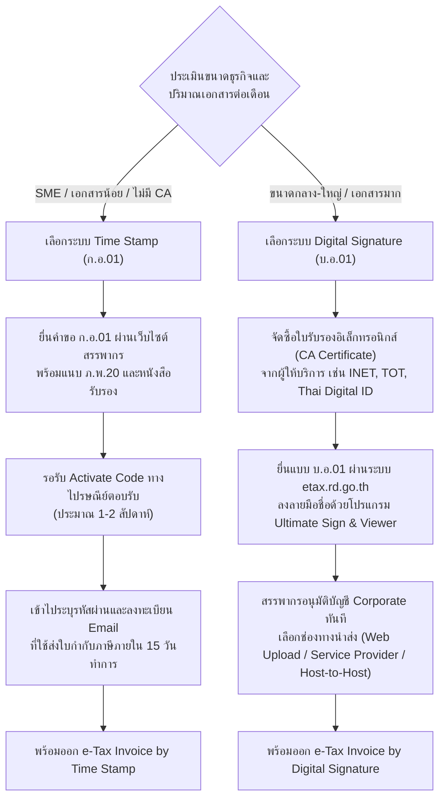

# คู่มือและมาตรฐานระบบใบกำกับภาษีอิเล็กทรอนิกส์และใบรับอิเล็กทรอนิกส์ (e-Tax Invoice & e-Receipt Guide)

แนวทางปฏิบัติและหลักเกณฑ์ทางกฎหมายตามระเบียบกรมสรรพากร ว่าด้วยการจัดทำ ส่งมอบ และเก็บรักษาใบกำกับภาษีอิเล็กทรอนิกส์และใบรับอิเล็กทรอนิกส์ การเปรียบเทียบระบบ Time Stamp (แบบ ก.อ.01) กับระบบ Digital Signature (แบบ บ.อ.01) ขั้นตอนการยื่นคำขอ และมาตรฐานความปลอดภัยทางอิเล็กทรอนิกส์

---

## 1. ขอบเขตประเภทเอกสารอิเล็กทรอนิกส์ 5 ประเภทตามกฎหมาย

ผู้ประกอบการจดทะเบียนภาษีมูลค่าเพิ่มที่ได้รับอนุมัติจากกรมสรรพากร สามารถจัดทำ ส่งมอบ และเก็บรักษาเอกสารในรูปแบบอิเล็กทรอนิกส์แทนเอกสารกระดาษได้ **5 ประเภท** โดยมีผลผูกพันทางกฎหมายเทียบเท่ากระดาษทุกประการ:

1. **ใบกำกับภาษีเต็มรูป** ตามประมวลรัษฎากร มาตรา 86/4
2. **ใบกำกับภาษีอย่างย่อ** ตามประมวลรัษฎากร มาตรา 86/6
3. **ใบเพิ่มหนี้ (Debit Note)** ตามประมวลรัษฎากร มาตรา 86/9
4. **ใบลดหนี้ (Credit Note)** ตามประมวลรัษฎากร มาตรา 86/10
5. **ใบรับ (e-Receipt)** ตามประมวลรัษฎากร มาตรา 105 ทวิ

---

## 2. ตารางเปรียบเทียบ 2 ระบบของกรมสรรพากร (Time Stamp vs Digital Signature)

| เกณฑ์การเปรียบเทียบ | e-Tax Invoice by Time Stamp | e-Tax Invoice & e-Receipt by Digital Signature |
| :--- | :--- | :--- |
| **กลุ่มเป้าหมายที่เหมาะสม** | **ผู้ประกอบการ SME** (เดิมจำกัดรายได้ไม่เกิน 30 ล้านบาท/ปี) ออกเอกสารไม่มาก | **ธุรกิจขนาดกลาง - องค์กรขนาดใหญ่** ไม่จำกัดรายได้ และมีปริมาณเอกสารจำนวนมาก |
| **แบบคำขอเข้าระบบ** | **แบบ ก.อ.01** (ยื่นผ่านหน้าเว็บกรมสรรพากร) | **แบบ บ.อ.01** (ยื่นผ่านระบบ e-Tax Invoice) |
| **วิธีการรับรองความถูกต้อง** | **การประทับรับรองเวลา (Time Stamp)** ผ่านระบบของ ETDA | **การลงลายมือชื่อดิจิทัล (Digital Signature)** ด้วยใบรับรองอิเล็กทรอนิกส์ |
| **ใบรับรองอิเล็กทรอนิกส์ (CA)** | **ไม่ต้องมี** ไม่มีค่าใช้จ่ายจัดซื้อใบรับรอง CA | **ต้องมี** จัดซื้อจากผู้ให้บริการ CA ภายใต้ Thailand NRCA |
| **รูปแบบไฟล์เอกสาร** | **ไฟล์ PDF** ส่งผ่านทางอีเมล | **ไฟล์ XML** ตามมาตรฐาน มธอ. (และ PDF/A-3 สำหรับมนุษย์อ่าน) |
| **กระบวนการส่งมอบและนำส่ง** | ส่งอีเมลหาผู้ซื้อ พร้อม CC ส่งไปที่ระบบ ETDA เพื่อประทับเวลา ระบบจะส่งต่อไปสรรพากรอัตโนมัติ | จัดส่งให้ผู้ซื้อทางช่องทางอิเล็กทรอนิกส์ และนำส่งไฟล์ XML เข้าสู่ระบบสรรพากร |
| **ช่องทางการนำส่งให้สรรพากร** | ผ่านระบบ Email Gateway ของ ETDA อัตโนมัติ | เลือกระหว่าง: Web Upload, Service Provider หรือ Host-to-Host |
| **ค่าใช้จ่ายระบบ** | **ฟรี** (ไม่มีค่าธรรมเนียมใบรับรอง CA) | มีค่าธรรมเนียมใบรับรอง CA และ/หรือค่าบริการ Service Provider |

---

## 3. ขั้นตอนการยื่นคำขอและการเริ่มใช้งาน

---

## 4. ช่องทางและกำหนดเวลานำส่งข้อมูลให้กรมสรรพากร

### 4.1 กำหนดเวลานำส่งข้อมูล
ผู้ประกอบการมีหน้าที่นำส่งข้อมูลเอกสารอิเล็กทรอนิกส์ที่ออกในเดือนภาษี ให้แก่กรมสรรพากร **ภายในวันที่ 15 ของเดือนถัดไป**

### 4.2 ช่องทางการนำส่ง (สำหรับระบบ Digital Signature)
1. **Web Upload:** ผู้ประกอบการลงชื่อเข้าใช้งานเว็บไซต์ etax.rd.go.th และอัปโหลดไฟล์ XML ที่ลง Digital Signature แล้ว เหมาะสำหรับกิจการที่ออกเอกสารไม่เกินเดือนละ 1,000 ฉบับ
2. **Service Provider:** เชื่อมต่อ API ผ่านผู้ให้บริการส่งข้อมูลที่ผ่านการรับรองจากกรมสรรพากร (เช่น INET) ผู้ให้บริการจะช่วยแปลงข้อมูล ลงลายมือชื่อ และนำส่งให้กรมสรรพากรโดยอัตโนมัติ
3. **Host-to-Host:** การเชื่อมต่อระบบคอมพิวเตอร์ของกิจการเข้ากับระบบของกรมสรรพากรโดยตรงด้วยช่องสัญญาณเฉพาะ (Leased Line) เหมาะสำหรับกิจการขนาดใหญ่ที่มีปริมาณเอกสาร **มากกว่า 500,000 ฉบับต่อเดือน**

---

## 5. มาตรฐานการจัดเก็บเอกสารทางอิเล็กทรอนิกส์ตามกฎหมาย

- **ระยะเวลาการจัดเก็บ:** ต้องเก็บรักษาข้อมูลอิเล็กทรอนิกส์ต้นฉบับไว้ **ไม่น้อยกว่า 5 ปี** และสามารถขยายได้ถึง **7 ปี** ตามมาตรา 87/3 แห่งประมวลรัษฎากร
- **ข้อกำหนดการเก็บรักษา:**
  - **ไม่ต้องพิมพ์เป็นกระดาษเพื่อจัดเก็บ** กฎหมายรับรองความสมบูรณ์ของไฟล์ดิจิทัลต้นฉบับ
  - ต้องสามารถเข้าถึงและนำกลับมาแสดงในรูปแบบที่อ่านออกได้ตลอดระยะเวลาการจัดเก็บ
  - ต้องเก็บรักษาไฟล์ในสภาพที่สามารถตรวจสอบความถูกต้องแท้จริงของต้นฉบับได้ (เช่น เก็บทั้งไฟล์ XML และ Certificate Signature)
  - แนะนำให้สำรองข้อมูล (Backup) ไว้อย่างน้อย 2 แหล่ง (Dual Storage) เช่น บนระบบ Cloud ที่ได้มาตรฐาน ISO 27001 ร่วมกับอุปกรณ์จัดเก็บข้อมูลภายในสำนักงาน

---

## 6. สิทธิประโยชน์และการเชื่อมโยงกับโครงการภาครัฐ (Easy E-Receipt)

- **โครงการสิทธิประโยชน์ทางภาษี (เช่น Easy E-Receipt):** กฎหมายกำหนดให้ผู้บริโภคบุคคลธรรมดาที่จะนำรายจ่ายจากการซื้อสินค้าหรือบริการไปหักลดหย่อนภาษี จะต้องได้รับหลักฐานเป็น **ใบกำกับภาษีอิเล็กทรอนิกส์เต็มรูป หรือใบรับอิเล็กทรอนิกส์ (e-Tax Invoice & e-Receipt)** เท่านั้น
- ผู้ประกอบการที่เข้าสู่ระบบ e-Tax Invoice จึงสร้างความได้เปรียบทางการแข่งขันในการดึงดูดลูกค้าและคู่ค้าธุรกิจ B2B ที่ต้องการเอกสารดิจิทัลไปใช้สิทธิภาษี

---

## 7. รายการตรวจสอบความปลอดภัยและข้อควรระวัง (Checklist & Precautions)

- [ ] ตรวจสอบว่ากิจการได้จดทะเบียนภาษีมูลค่าเพิ่ม (มี ภ.พ.20) ก่อนยื่นคำขอเสมอ
- [ ] หากใช้วิธี Time Stamp ต้องตรวจสอบความถูกต้องของ Email ผู้ซื้อก่อนกดส่งทุกครั้ง เพื่อป้องกันเอกสารส่งไม่ถึงมือลูกค้า
- [ ] หมั่นตรวจสอบสถานะการนำส่งข้อมูลบนระบบ etax.rd.go.th ภายในวันที่ 15 ของทุกเดือน เพื่อป้องกันการถูกเพิกถอนสิทธิ
- [ ] ตรวจสอบอายุของใบรับรองอิเล็กทรอนิกส์ (CA) สม่ำเสมอ และดำเนินการต่ออายุก่อนหมดอายุอย่างน้อย 30 วัน
- [ ] หากมีการเลิกกิจการหรือโอนย้ายกิจการ ต้องแจ้งยกเลิกการใช้ระบบ e-Tax Invoice ต่อกรมสรรพากรเป็นลายลักษณ์อักษร
