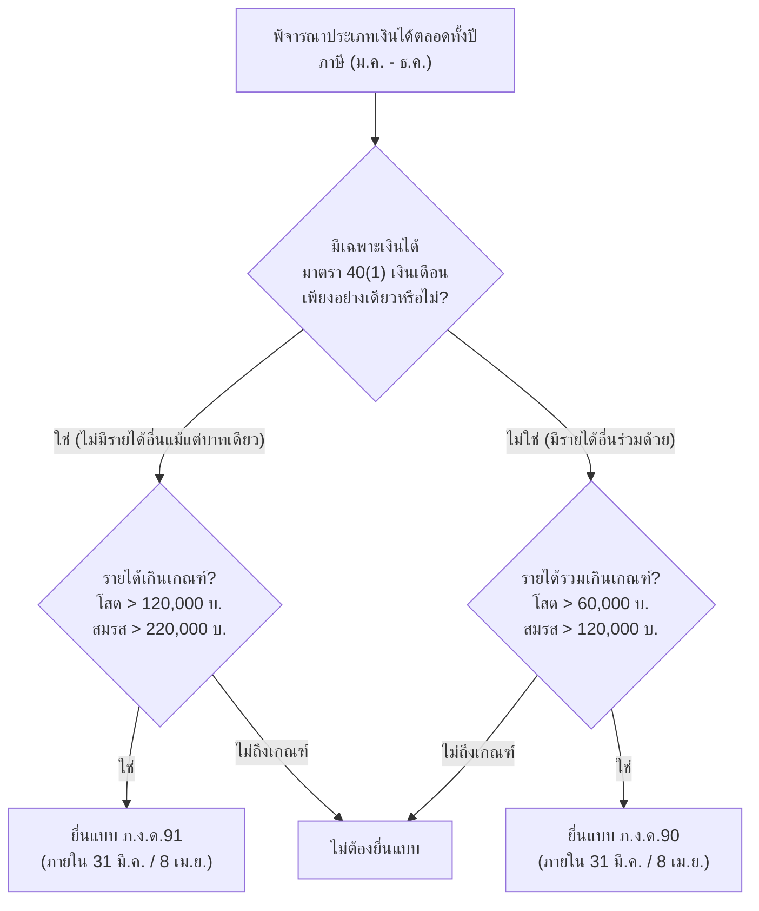

# คู่มือการเปรียบเทียบและเลือกระหว่างแบบ ภ.ง.ด.90 กับ ภ.ง.ด.91 (PND 90 vs PND 91 Guide)

แนวทางปฏิบัติและหลักเกณฑ์ทางกฎหมายตามประมวลรัษฎากรสำหรับการเลือกยื่นแบบแสดงรายการภาษีเงินได้บุคคลธรรมดาประจำปี ระหว่างแบบ ภ.ง.ด.90 และ ภ.ง.ด.91 การตรวจสอบเกณฑ์รายได้ขั้นต่ำ การจำแนกประเภทเงินได้ตามมาตรา 40(1)-(8) การแก้ไขกรณียื่นผิดแบบ และการเปรียบเทียบกับแบบ ภ.ง.ด.94

---

## 1. ตารางเปรียบเทียบโครงสร้างแบบ ภ.ง.ด.90 vs ภ.ง.ด.91

| มิติการเปรียบเทียบ | ภ.ง.ด.91 | ภ.ง.ด.90 |
| :--- | :--- | :--- |
| **ประเภทเงินได้ที่ครอบคลุม** | **มาตรา 40(1) ประเภทเดียวเท่านั้น** (เงินเดือน ค่าจ้าง โบนัส เบี้ยเลี้ยง บำเหน็จ) | **มีเงินได้ประเภทอื่น 40(2) ถึง 40(8)** หรือมี 40(1) ร่วมกับประเภทอื่น |
| **กลุ่มผู้เสียภาษีหลัก** | พนักงานประจำ, ลูกจ้างรายเดือน, ข้าราชการ ที่ไม่มีรายได้เสริม | ฟรีแลนซ์, ค้าขายออนไลน์, เจ้าของกิจการ, ผู้ให้เช่า, ผู้มีเงินปันผล/ดอกเบี้ย |
| **เกณฑ์ขั้นต่ำที่ต้องยื่น (คนโสด)** | เงินได้พึงประเมินทั้งปี **เกิน 120,000 บาท** | เงินได้พึงประเมินทั้งปี **เกิน 60,000 บาท** |
| **เกณฑ์ขั้นต่ำที่ต้องยื่น (มีคู่สมรส)** | เงินได้พึงประเมินรวมกัน **เกิน 220,000 บาท** | เงินได้พึงประเมินรวมกัน **เกิน 120,000 บาท** |
| **การหักค่าใช้จ่ายเหมา** | หักเหมา 50% สูงสุดไม่เกิน 100,000 บาท | หักตามประเภทเงินได้ (หักเหมาตาม พ.ร.ฎ. ฉบับที่ 11 หรือหักตามจริง) |
| **การคำนวณภาษีวิธีที่ 2 (ม.48)** | **ไม่ต้องคำนวณ** (คำนวณวิธีขั้นบันไดอย่างเดียว) | **ต้องคำนวณเปรียบเทียบ** หากมีเงินได้ 40(2)-(8) รวมกันเกิน 120,000 บาท |
| **กำหนดยื่นแบบกระดาษ** | ภายใน 31 มีนาคม ของปีถัดไป | ภายใน 31 มีนาคม ของปีถัดไป |
| **กำหนดยื่นแบบ e-Filing** | ภายใน 8 เมษายน ของปีถัดไป | ภายใน 8 เมษายน ของปีถัดไป |

> [!IMPORTANT] เกณฑ์การยื่นแบบตามกฎหมาย
> หากเงินได้พึงประเมินถึงเกณฑ์ขั้นต่ำตามกฎหมาย ผู้มีเงินได้ **มีหน้าที่ตามกฎหมายที่จะต้องยื่นแบบแสดงรายการ แม้ว่าเมื่อคำนวณหักค่าใช้จ่ายและค่าลดหย่อนแล้วจะมียอดภาษีที่ต้องชำระเป็นศูนย์ (0 บาท) ก็ตาม**

---

## 2. การวิเคราะห์ 4 สถานการณ์ในชีวิตจริง (Decision Framework)

### สถานการณ์ที่ 1: มนุษย์เงินเดือนประจำล้วนๆ
- **กรณีศึกษา:** พนักงานเอกชน เงินเดือน 35,000 บาท โบนัส 35,000 บาท รวมรายได้ 455,000 บาท ไม่มีรายได้ทางอื่น
- **แบบที่ต้องยื่น:** **ภ.ง.ด.91** (เพราะเป็นเงินได้ 40(1) ทางเดียวจากนายจ้าง)

### สถานการณ์ที่ 2: มนุษย์เงินเดือนที่มีรายได้เสริมขายของออนไลน์
- **กรณีศึกษา:** พนักงานเงินเดือน 28,000 บาท และมีร้านค้าขายเสื้อผ้าใน Shopee/TikTok ได้กำไรหรือยอดขายเข้ามา
- **แบบที่ต้องยื่น:** **ภ.ง.ด.90** (เงินเดือนคือ 40(1) ยอดขายออนไลน์คือ 40(8) มีมากกว่า 1 ประเภท ต้องเปลี่ยนมายื่น ภ.ง.ด.90 ทันที)

### สถานการณ์ที่ 3: ฟรีแลนซ์รับจ้างอิสระเต็มตัว
- **กรณีศึกษา:** กราฟิกดีไซเนอร์ หรือโปรแกรมเมอร์อิสระ รับจ้างทำของ รายได้รวมทั้งปี 480,000 บาท โดยไม่มีสัญญาจ้างแรงงานประจำ
- **แบบที่ต้องยื่น:** **ภ.ง.ด.90** (รายได้จัดเป็น 40(2) จ้างทำของ หรือ 40(6) วิชาชีพบัญชี/วิศวกร หรือ 40(8) ตามลักษณะสัญญา)

### สถานการณ์ที่ 4: ข้าราชการ/ผู้บริหารที่มีอสังหาริมทรัพย์ปล่อยเช่า
- **กรณีศึกษา:** ข้าราชการเงินเดือน 32,000 บาท มีคอนโดมิเนียมปล่อยเช่าได้รับค่าเช่าเดือนละ 12,000 บาท
- **แบบที่ต้องยื่น:** **ภ.ง.ด.90** (มีเงินได้ 40(1) และเงินได้ค่าเช่าทรัพย์สิน 40(5))

---

## 3. กฎเหล็กทางภาษีที่ต้องระวังในการยื่นแบบ ภ.ง.ด.90

### 3.1 เพดานหักค่าใช้จ่ายร่วมกันของ 40(1) และ 40(2) (มาตรา 42 ทวิ)
หากผู้เสียภาษีมีทั้งเงินเดือนประจำ 40(1) และค่าคอมมิชชัน/รับจ้างอิสระ 40(2) กฎหมายกำหนดให้หักค่าใช้จ่ายเหมา 50% **รวมกันทั้งสองประเภทสูงสุดไม่เกิน 100,000 บาท** ไม่สามารถแยกหักประเภทละ 100,000 บาทได้

### 3.2 การคำนวณภาษีวิธีที่ 2 (มาตรา 48)
หากมีเงินได้ประเภท 40(2) ถึง 40(8) รวมกัน **เกิน 120,000 บาทต่อปี** ต้องนำยอดเงินได้ดังกล่าว (ก่อนหักค่าใช้จ่าย) มาคูณ **0.5% (0.005)**:
- หากผลลัพธ์ **ไม่เกิน 5,000 บาท:** ได้รับยกเว้น ให้เสียภาษีตามวิธีที่ 1 (อัตราขั้นบันได)
- หากผลลัพธ์ **เกิน 5,000 บาท:** ให้เปรียบเทียบกับภาษีตามวิธีที่ 1 และ **เสียภาษีตามจำนวนที่สูงกว่า**

---

## 4. แนวทางแก้ไขเมื่อยื่นแบบผิด (ยื่น ภ.ง.ด.91 แทนที่จะเป็น ภ.ง.ด.90)

| กรณี | ขั้นตอนการปฏิบัติและแก้ไข | ผลกระทบเรื่องค่าปรับและเงินเพิ่ม |
| :--- | :--- | :--- |
| **ยังอยู่ในกำหนดเวลา** (ภายใน 31 มี.ค. หรือ 8 เม.ย.) | เข้าสู่ระบบ e-Filing ของกรมสรรพากร เลือกยื่นแบบ ภ.ง.ด.90 เพิ่มเติม ระบบจะดึงข้อมูลเดิมและคำนวณภาษีส่วนต่างให้ | **ไม่มีค่าปรับอาญาและไม่มีเงินเพิ่ม** หากชำระภาษีส่วนต่างครบภายในกำหนดเวลา |
| **พ้นกำหนดเวลาไปแล้ว** | ต้องจัดทำแบบ ภ.ง.ด.90 ในรูปแบบกระดาษ พร้อมนำเอกสารหลักฐานทั้งหมดไปยื่น ณ สำนักงานสรรพากรพื้นที่สาขา | • **ไม่ต้องเสียค่าปรับอาญา** มาตรา 35 (ถือว่ามีเจตนายื่นแบบเดิมในกำหนดแล้ว) • **ต้องเสียเงินเพิ่มร้อยละ 1.5 ต่อเดือน** (มาตรา 27) ของยอดภาษีที่ต้องชำระเพิ่มเติม |

---

## 5. ความแตกต่างระหว่าง ภ.ง.ด.90 / ภ.ง.ด.91 กับ ภ.ง.ด.94 (ภาษีครึ่งปี)

| แบบแสดงรายการ | ช่วงเวลาของเงินได้ที่นำมาคำนวณ | ประเภทเงินได้ที่เกี่ยวข้อง | กำหนดเวลายื่นแบบ |
| :--- | :--- | :--- | :--- |
| **ภ.ง.ด.94 (ภาษีครึ่งปี)** | เงินได้ที่ได้รับตั้งแต่วันที่ **1 ม.ค. ถึง 30 มิ.ย.** ของปีภาษีนั้น | เฉพาะเงินได้ประเภท **มาตรา 40(5), (6), (7), (8)** เท่านั้น | ภายใน **30 กันยายน** (กระดาษ) หรือ **8 ตุลาคม** (ออนไลน์) |
| **ภ.ง.ด.90 (ภาษีทั้งปี)** | เงินได้ที่ได้รับตั้งแต่วันที่ **1 ม.ค. ถึง 31 ธ.ค.** ของปีภาษีนั้น | เงินได้ทุกประเภท **มาตรา 40(1) ถึง 40(8)** | ภายใน **31 มีนาคม** (กระดาษ) หรือ **8 เมษายน** (ออนไลน์) |
| **ภ.ง.ด.91 (ภาษีทั้งปี)** | เงินได้ที่ได้รับตั้งแต่วันที่ **1 ม.ค. ถึง 31 ธ.ค.** ของปีภาษีนั้น | เฉพาะเงินได้ **มาตรา 40(1) ประเภทเดียว** | ภายใน **31 มีนาคม** (กระดาษ) หรือ **8 เมษายน** (ออนไลน์) |

*(หมายเหตุ: ภาษีที่จ่ายชำระตามแบบ ภ.ง.ด.94 ในช่วงครึ่งปีแรก ให้นำมาหักเป็นเครดิตภาษีออกจากภาษีที่ต้องชำระในแบบ ภ.ง.ด.90 ปลายปีได้เต็มจำนวน)*
